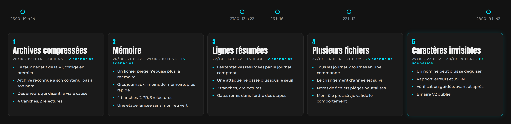

# brutect — Retour d'expérience

**Livrer un outil de cybersécurité en Rust sans connaître Rust, avec une IA et une méthode**

octobre 2026

Outil : [brutect](README.md) · Version PDF : [brutect-retour-experience.pdf](brutect-retour-experience.pdf) · Retex précédent : [Djodjo's Gallery](../../djodjos-gallery-retex/README.md)

> **Ce n'est pas fini.** `brutect` en est à sa V2. Ses limites restantes sont listées pour la suite, et deux autres outils doivent suivre. Ce document est un point d'étape : il sera mis à jour.

## En bref

`brutect` lit un journal d'authentification Linux (`auth.log`) et dit quelles IP ont tenté de deviner un mot de passe SSH, quels comptes elles ont visés, et si l'une d'elles a fini par se connecter.

Le 22 octobre 2026 à 13 h 51, le dossier ne contenait qu'un « Hello, world! ». À 18 h 11, la V1 était cadrée, construite, relue trois fois, livrée, et ses leçons étaient écrites. Je ne connaissais pas Rust. **Claude (IA)**, l'assistant d'Anthropic, a écrit le code ; j'ai tenu le rôle de Product Owner.

Ce résultat, je le dois à **la méthode de travail avec l'IA partagée par [SFEIR](https://github.com/clubgenai/workshop-software-development-life-cycle)**, lors de son workshop « Intégrer l'IA dans son SDLC ». Sans elle, j'aurais obtenu du code. Avec elle, j'ai obtenu un outil testé, relu et documenté, dont je peux expliquer chaque décision.

Du 26 au 28 octobre, la V2 a suivi la même méthode, en cinq lots livrés chacun par sa propre pull request : les archives compressées reçues par un tube, la mémoire, les lignes que le journal résume, plusieurs fichiers d'un coup, et les caractères invisibles. Elle vise aussi un administrateur qui analyse les journaux de son propre serveur.

| Indicateur | V1 (22 octobre) | Avec la V2 (28 octobre) |
|---|---|---|
| Durée | 4 h 20, du premier commit à la fusion | 5 lots en trois jours |
| Scénarios d'acceptation, écrits avant le code | 30 | 102 |
| Tests au vert | 91 : 52 unitaires, 39 qui lancent le vrai binaire | 171 : 83 unitaires, 88 qui lancent le vrai binaire |
| Code | environ 1 700 lignes de Rust (tests unitaires compris), 570 lignes de tests d'intégration | environ 3 150 lignes de Rust, 2 340 lignes de tests d'intégration |
| Construction | 8 tranches, une par commit | 24 tranches |
| Relectures, chacune par un agent qui n'avait pas écrit le code | 3 | 13 |
| Règles apprises par l'IA | 3 | 19 |
| Dépendances, chacune justifiée et validée par moi | 4 | 4, aucune ajoutée |
| Plantage possible sur un fichier piégé | aucun | aucun |

**Ce que le projet m'a fait pratiquer :** la lecture des journaux SSH (forensique), la détection par fenêtre glissante, les entrées hostiles (séquences de terminal, caractères bidirectionnels, octets invalides), l'échappement JSON, le rôle de Product Owner, l'écriture de scénarios d'acceptation, la relecture d'un travail fait par une IA, Git et GitHub en pull requests. La V2 y a ajouté la rotation et la compression des journaux, la mémoire face à un fichier piégé, Unicode et ses caractères invisibles, et la vérification de comportement avant et après une livraison.

## La V1 en cinq temps

## La méthode SFEIR

**Cinq commandes, et l'humain valide chaque étape.** Je les ai reprises telles quelles du workshop de SFEIR, adaptées à Rust.

| Commande | Ce que fait l'IA | Ce que je fais |
|---|---|---|
| `/cadrer` | Écrit la spec : intention, scénarios d'acceptation, hors périmètre, plan, dépendances | Je tranche les questions et je coche deux gates : besoin validé, plan validé |
| `/construire` | Code tranche par tranche, en commençant par des tests qui échouent, et prouve chaque tranche | Je valide chaque dépendance et chaque test modifié |
| `/relire` | Lance un relecteur qui n'a pas écrit le code, et qui essaie de casser l'outil | J'arbitre chaque réserve : corriger maintenant ou noter pour la V2 |
| `/livrer` | Prépare le changelog, la mise en service, le retour arrière, les limites connues | Je coche le gate de livraison et je fusionne |
| `/capitaliser` | Propose des règles tirées des incidents | Je choisis celles qui entrent dans la mémoire du projet |

**La spec fait foi.** Scénarios, arbitrages, preuves, verdicts des relectures, coût : tout y est écrit. N'importe quel agent peut reprendre le travail en la lisant.

**Les gates sont humains.** L'IA ne coche jamais une case de validation. Elle propose, je décide.

**Chaque erreur devient une règle.** Elle est écrite dans un fichier que l'IA relit à chaque session. Le projet suivant part avec.

## Qui a fait quoi

| Moi | Claude (IA) |
|---|---|
| Le choix de l'outil parmi trois idées, et son public : quelqu'un qui apprend la cybersécurité ou résout un CTF | Les questions de cadrage, la spec et les 30 scénarios |
| Les arbitrages : ce qui compte comme ligne ignorée, ce qui part en V2 | Tout le code Rust et tous les tests |
| La validation de chaque dépendance et de chaque test modifié | Les trois relectures, par des agents indépendants |
| Les commandes Git et GitHub, tapées par moi : branches, commits, pull requests, fusion | Les commandes à taper, et la vérification après coup |
| Les quatre gates, le choix des règles retenues | Le changelog, la procédure de retour arrière, la publication du binaire |

## Ce que les relectures ont trouvé

**Les 27 scénarios passaient. Les relecteurs ont quand même trouvé des failles,** en essayant de casser l'outil avec un log piégé.

**Un nom d'utilisateur pouvait piloter le terminal de l'analyste.** L'attaquant choisit le nom qu'il essaie. Avec une séquence de contrôle dedans, le rapport pouvait colorer ou effacer des lignes à l'écran. Corrigé avant la livraison : ces caractères sont maintenant neutralisés.

*Séquence de contrôle : des caractères invisibles qu'un terminal interprète comme des ordres (couleur, effacement, déplacement du curseur).*

**`toor` pouvait s'afficher comme `root`.** Des caractères qui inversent le sens de lecture rendaient un nom trompeur. Corrigé, comme les caractères de contrôle restés bruts dans la sortie JSON.

**Un outil de sécurité lit des données écrites par l'attaquant.** Mes tests vérifiaient que l'outil ne plantait pas, pas ce qu'il affichait. C'est la leçon principale du projet.

## Incidents et leçons

| Incident | Cause | Ce que j'en retiens |
|---|---|---|
| 3 relectures et 8 tranches au lieu de 6 (erreur de Claude) | Les scénarios d'entrée piégée vérifiaient l'absence de plantage, pas le contenu affiché | Dès le cadrage, un scénario hostile par format de sortie, qui vérifie ce qui sort |
| Une version périmée de la spec a failli effacer le travail précédent | Le fichier, ouvert dans mon éditeur, avait changé sur le disque | Avant chaque commit, l'IA vérifie qu'aucune ligne n'a disparu sans raison |
| Le coût des premières sessions est perdu | J'ai remis la conversation à zéro avant de relever le compteur | Relever le coût à la fin de chaque étape |
| Un cas d'usage mal géré, vu à la livraison seulement (erreur de Claude) ; et j'ai fusionné la V1 sans lire ses 2 000 lignes | Trois relecteurs, tous des IA, ne l'ont pas vu ; je me suis fié au processus | La prochaine V1 sera découpée pour que je la relise moi-même |

**Le coût.** Seule la dernière session a été mesurée : **4,30 $** pour 49 minutes, dont 10 % pour les relecteurs. C'est peu pour ce qu'ils ont trouvé.

## La V2 : cinq lots en trois jours

**Un lot, une pull request, un cycle complet.** Chaque lot a repris les cinq commandes, du cadrage à la capitalisation. La V1 avait tout livré d'un bloc ; la V2 a été découpée en lots plus petits, et le plus urgent est passé en premier : le cas d'usage mal géré trouvé à la livraison de la V1.

**Une attaque ne passe plus sous le seuil.** Quand un attaquant enchaîne les essais, le journal système peut les résumer en une seule ligne. La V1 ignorait ces lignes : maintenant, chaque tentative résumée compte.

**Tous les journaux d'un serveur en une commande.** Un serveur range ses journaux en plusieurs fichiers, compressés ou non. La V2 les lit ensemble, dans un seul rapport, et suit le changement d'année : une attaque le 31 décembre suivie d'une connexion le 2 janvier est vue entière.

### Qui a fait quoi, en V2

Le partage est resté le même, avec deux changements, décidés par moi :

- **Git** : depuis le 26 octobre, l'IA lance elle-même les commandes Git locales (branche, commit) et les vérifie. Ce qui sort de ma machine, l'envoi et l'ouverture des pull requests, reste confirmé par moi, et c'est toujours moi qui fusionne.
- **Mon rôle de Product Owner, précisé** : je valide ce que fait l'outil, pas la façon dont il est écrit. Après la V1, j'avais noté que je fusionnais du code sans l'avoir lu. Pour la V2, j'ai choisi d'assumer ce partage plutôt que de faire semblant : la lecture du code revient à un relecteur indépendant, et je vérifie moi-même le comportement sur des exemples réels, avant et après la mise à jour, guidé pas à pas par l'IA.

### Ce que les relectures ont trouvé

**Dix relectures, et des failles trouvées presque à chaque fois,** alors que tous les scénarios passaient.

**Un fichier piégé pouvait épuiser la mémoire.** Une petite archive qui se déplie en ligne géante, des noms ou des dates démesurés : la machine de l'analyste pouvait saturer. Corrigé : les lignes, les noms tentés et les dates démesurés sont maintenant coupés ou refusés.

**Un nom de fichier est une entrée hostile.** Lancé sur tous les fichiers d'un dossier, l'outil pouvait laisser un nom de fichier piégé agir sur le terminal, ou changer ses propres réglages en silence et manquer une attaque. Corrigé.

**Un nom d'utilisateur pouvait se déguiser.** Un caractère invisible glissé au milieu de `root` donnait un autre nom, affiché à l'identique. D'autres pouvaient cacher du texte, par exemple des consignes destinées à une IA à qui l'on confierait le rapport. Ces caractères s'affichent maintenant en toutes lettres.

**Des tests qui ne pouvaient pas échouer.** Un test qui passe toujours ne protège de rien. Désormais, l'IA montre chaque nouveau test en échec avant de le valider.

### Incidents et leçons de la V2

| Incident | Cause | Ce que j'en retiens |
|---|---|---|
| L'IA a démarré une étape sans mon feu vert (erreur de Claude) | Elle a pris mes réponses à des questions pour un feu vert | Une étape ne démarre que sur ma commande |
| Des exemples de caractères invisibles écrits par l'IA sont devenus de vrais caractères invisibles, quatre fois (erreur de Claude) | L'outil d'écriture remplace le code d'un caractère par le caractère lui-même | Tout texte qui en contient est contrôlé juste après l'écriture. Une simple note n'avait pas suffi |
| Des oublis revenus alors que la règle était déjà écrite (erreur de Claude) | Une règle sans contrôle se laisse oublier | Chaque règle s'accompagne d'une vérification à lancer avant l'étape suivante |
| La taille estimée dépassée quatre lots de suite (erreur de Claude) | Les réécritures et les tests étaient sous-estimés | Une réécriture compte deux fois, les tests sont estimés d'après le lot précédent |
| Trois chiffres faux dans un cadrage (erreur de Claude) | Écrits de mémoire, sans vérification | Chaque chiffre sur le code vient d'une commande montrée |
| La vérification de comportement d'un lot a été faite après la fusion | Les commandes étaient données, mais pas la marche à suivre | L'IA me guide pas à pas, avant puis après la mise à jour, et avant la fusion |

### Le coût et la taille

**Environ 64 $ relevés pour toute la V2,** de 8 à 18 $ par lot, relectures comprises. Deux étapes n'ont pas été relevées. Ces chiffres sont approximatifs : j'utilise Claude pour d'autres sujets en même temps, et le compteur additionne tout ce que je lui demande pendant la session.

**La taille, elle, a été mesurée à chaque tranche.** Elle a dépassé l'estimation quatre lots de suite. Chaque écart a affiné la règle d'estimation ; le prochain lot dira si elle suffit.

## Ce que j'en retiens

**Rust et l'IA vont bien ensemble.** Le compilateur refuse un programme dès qu'une erreur de type, de mémoire ou un cas oublié apparaît, et il explique pourquoi. L'IA corrige ses erreurs avant même de lancer le programme.

**La méthode compte plus que le langage.** Je n'aurais pas su écrire ce code. J'ai su dire ce qu'il devait faire, écrire ce qui comptait comme réussi, arbitrer les réserves et refuser une livraison incomplète. C'est le travail que la méthode de SFEIR m'a appris à tenir.

**Le piège reste le même.** Dans le retex de Djodjo's Gallery, j'écrivais qu'à force de laisser l'IA coder, j'avais l'impression de pouvoir m'en tirer avec quelques notions. Ici aussi, l'IA a écrit tout le code, et j'ai fusionné la V1 sans l'avoir lue. En cybersécurité, il faut comprendre ce qu'on défend. C'est pour ça que je continue mes cours de Python, où c'est moi qui écris le code.

**Avec la V2, je valide ce que fait l'outil, pas la façon dont il est écrit.** C'est un rôle que j'assume : dire ce qui compte comme réussi, arbitrer, et vérifier le comportement sur un vrai journal, avant et après chaque mise à jour. La lecture du code, je la confie à un relecteur qui ne l'a pas écrit, et la V2 en a lancé dix.

**Une règle écrite ne suffit pas.** Certaines erreurs sont revenues alors que la règle existait déjà. Chaque récidive m'a appris à rendre la règle vérifiable : une commande à lancer, un résultat à montrer.

## La suite

Ce n'est pas fini. Dans l'ordre :

- **La V3 de `brutect`** : les limites restantes de la V2 sont listées et classées, la plus gênante en premier.
- **Des lots qui tiennent leur estimation de taille**, avec les règles apprises en V2.
- **Une boîte à outils CTF** en Rust : encodages (base64, hexadécimal, ROT13), XOR, identification de hash et de type de fichier.
- **Un détecteur de secrets** dans un dépôt Git, à la manière de gitleaks.

Chacun suivra les cinq commandes de la méthode SFEIR, avec les règles déjà apprises ici. Merci à **SFEIR** pour cette méthode, partagée librement : [workshop-software-development-life-cycle](https://github.com/clubgenai/workshop-software-development-life-cycle). Me contacter : par le [formulaire de mon site](https://djos-galley.online/about.html).

