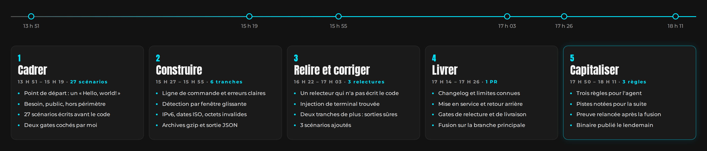

# brutect — Retour d'expérience

**Livrer un outil de cybersécurité en Rust sans connaître Rust, avec une IA et une méthode**

Geoffroy, alias Djodjo · en reconversion vers la cybersécurité (blue team) · octobre 2026

Outil : [brutect](README.md) · Version PDF : [brutect-retour-experience.pdf](brutect-retour-experience.pdf) · Retex précédent : [Djodjo's Gallery](../../djodjos-gallery-retex/README.md)

> **Ce n'est pas fini.** `brutect` en est à sa V1. La V2 est déjà listée, et deux autres outils doivent suivre. Ce document est un point d'étape : il sera mis à jour.

## En bref

`brutect` lit un journal d'authentification Linux (`auth.log`) et dit quelles IP ont tenté de deviner un mot de passe SSH, quels comptes elles ont visés, et si l'une d'elles a fini par se connecter.

Le 22 octobre 2026 à 13 h 51, le dossier ne contenait qu'un « Hello, world! ». À 18 h 11, la V1 était cadrée, construite, relue trois fois, livrée, et ses leçons étaient écrites. Je ne connaissais pas Rust. **Claude (IA)**, l'assistant d'Anthropic, a écrit le code ; j'ai tenu le rôle de Product Owner.

Ce résultat, je le dois à **la méthode de travail avec l'IA partagée par [SFEIR](https://github.com/clubgenai/workshop-software-development-life-cycle)**, lors de son workshop « Intégrer l'IA dans son SDLC ». Sans elle, j'aurais obtenu du code. Avec elle, j'ai obtenu un outil testé, relu et documenté, dont je peux expliquer chaque décision.

| Indicateur | Valeur |
|---|---|
| Du premier commit à la V1 fusionnée | 4 h 20, le 22 octobre |
| Scénarios d'acceptation | 30, écrits avant le code (27 au cadrage, 3 après les relectures) |
| Tests | 91 au vert : 52 unitaires, 39 qui lancent le vrai binaire |
| Code | environ 1 700 lignes de Rust (tests unitaires compris), 570 lignes de tests d'intégration |
| Construction | 8 tranches, une par commit, chacune avec ses scénarios |
| Relectures | 3, chacune par un agent qui n'avait pas écrit le code |
| Dépendances | 4 bibliothèques, chacune justifiée et validée par moi |
| Plantage possible sur un fichier piégé | aucun |

**Ce que le projet m'a fait pratiquer :** la lecture des journaux SSH (forensique), la détection par fenêtre glissante, les entrées hostiles (séquences de terminal, caractères bidirectionnels, octets invalides), l'échappement JSON, le rôle de Product Owner, l'écriture de scénarios d'acceptation, la relecture d'un travail fait par une IA, Git et GitHub en pull requests.

## Le projet en cinq temps

## La méthode SFEIR

**Cinq commandes, et l'humain valide chaque étape.** Je les ai reprises telles quelles du workshop de SFEIR, adaptées à Rust.

| Commande | Ce que fait l'IA | Ce que je fais |
|---|---|---|
| `/cadrer` | Écrit la spec : intention, scénarios d'acceptation, hors périmètre, plan, dépendances | Je tranche les questions et je coche deux gates : besoin validé, plan validé |
| `/construire` | Code tranche par tranche, en commençant par des tests qui échouent, et prouve chaque tranche | Je valide chaque dépendance et chaque test modifié |
| `/relire` | Lance un relecteur qui n'a pas écrit le code, et qui essaie de casser l'outil | J'arbitre chaque réserve : corriger maintenant ou noter pour la V2 |
| `/livrer` | Prépare le changelog, la mise en service, le retour arrière, les limites connues | Je coche le gate de livraison et je fusionne |
| `/capitaliser` | Propose des règles tirées des incidents | Je choisis celles qui entrent dans la mémoire du projet |

**La spec fait foi.** Scénarios, arbitrages, preuves, verdicts des relectures, coût : tout y est écrit. N'importe quel agent peut reprendre le travail en la lisant.

**Les gates sont humains.** L'IA ne coche jamais une case de validation. Elle propose, je décide.

**Chaque erreur devient une règle.** Elle est écrite dans un fichier que l'IA relit à chaque session. Le projet suivant part avec.

## Qui a fait quoi

| Moi (Geoffroy) | Claude (IA) |
|---|---|
| Le choix de l'outil parmi trois idées, et son public : quelqu'un qui apprend la cybersécurité ou résout un CTF | Les questions de cadrage, la spec et les 30 scénarios |
| Les arbitrages : ce qui compte comme ligne ignorée, ce qui part en V2 | Tout le code Rust et tous les tests |
| La validation de chaque dépendance et de chaque test modifié | Les trois relectures, par des agents indépendants |
| Les commandes Git et GitHub, tapées par moi : branches, commits, pull requests, fusion | Les commandes à taper, et la vérification après coup |
| Les quatre gates, le choix des règles retenues | Le changelog, la procédure de retour arrière, la publication du binaire |

## Ce que les relectures ont trouvé

**Les 27 scénarios passaient. Les relecteurs ont quand même trouvé des failles,** en essayant de casser l'outil avec un log piégé.

**Un nom d'utilisateur pouvait piloter le terminal de l'analyste.** L'attaquant choisit le nom qu'il essaie. Avec une séquence de contrôle dedans, le rapport pouvait colorer ou effacer des lignes à l'écran. Corrigé avant la livraison : ces caractères sont maintenant neutralisés.

*Séquence de contrôle : des caractères invisibles qu'un terminal interprète comme des ordres (couleur, effacement, déplacement du curseur).*

**`toor` pouvait s'afficher comme `root`.** Des caractères qui inversent le sens de lecture rendaient un nom trompeur. Corrigé, comme les caractères de contrôle restés bruts dans la sortie JSON.

**Un outil de sécurité lit des données écrites par l'attaquant.** Mes tests vérifiaient que l'outil ne plantait pas, pas ce qu'il affichait. C'est la leçon principale du projet.

## Incidents et leçons

| Incident | Cause | Ce que j'en retiens |
|---|---|---|
| 3 relectures et 8 tranches au lieu de 6 (erreur de Claude) | Les scénarios d'entrée piégée vérifiaient l'absence de plantage, pas le contenu affiché | Dès le cadrage, un scénario hostile par format de sortie, qui vérifie ce qui sort |
| Une version périmée de la spec a failli effacer le travail précédent | Le fichier, ouvert dans mon éditeur, avait changé sur le disque | Avant chaque commit, l'IA vérifie qu'aucune ligne n'a disparu sans raison |
| Le coût des premières sessions est perdu | J'ai remis la conversation à zéro avant de relever le compteur | Relever le coût à la fin de chaque étape |
| Un cas d'usage mal géré, vu à la livraison seulement (erreur de Claude) ; et j'ai fusionné la V1 sans lire ses 2 000 lignes | Trois relecteurs, tous des IA, ne l'ont pas vu ; je me suis fié au processus | La prochaine V1 sera découpée pour que je la relise moi-même |

**Le coût.** Seule la dernière session a été mesurée : **4,30 $** pour 49 minutes, dont 10 % pour les relecteurs. C'est peu pour ce qu'ils ont trouvé.

## Ce que j'en retiens

**Rust et l'IA vont bien ensemble.** Le compilateur refuse un programme dès qu'une erreur de type, de mémoire ou un cas oublié apparaît, et il explique pourquoi. L'IA corrige ses erreurs avant même de lancer le programme.

**La méthode compte plus que le langage.** Je n'aurais pas su écrire ce code. J'ai su dire ce qu'il devait faire, écrire ce qui comptait comme réussi, arbitrer les réserves et refuser une livraison incomplète. C'est le travail que la méthode de SFEIR m'a appris à tenir.

**Le piège reste le même.** Dans le retex de Djodjo's Gallery, j'écrivais qu'à force de laisser l'IA coder, j'avais l'impression de pouvoir m'en tirer avec quelques notions. Ici aussi, l'IA a écrit tout le code, et j'ai fusionné la V1 sans l'avoir lue. En cybersécurité, il faut comprendre ce qu'on défend. C'est pour ça que je continue mes cours de Python, où c'est moi qui écris le code.

## La suite

Ce n'est pas fini. Dans l'ordre :

- **La V2 de `brutect`** : ses limites connues sont listées et classées, la plus gênante en premier.
- **Des PR plus petites**, que je relis moi-même, ligne par ligne.
- **Une boîte à outils CTF** en Rust : encodages (base64, hexadécimal, ROT13), XOR, identification de hash et de type de fichier.
- **Un détecteur de secrets** dans un dépôt Git, à la manière de gitleaks.

Chacun suivra les cinq commandes de la méthode SFEIR, avec les règles déjà apprises ici. Merci à **SFEIR** pour cette méthode, partagée librement : [workshop-software-development-life-cycle](https://github.com/clubgenai/workshop-software-development-life-cycle). Me contacter : par le [formulaire de mon site](https://djos-galley.online/about.html).

