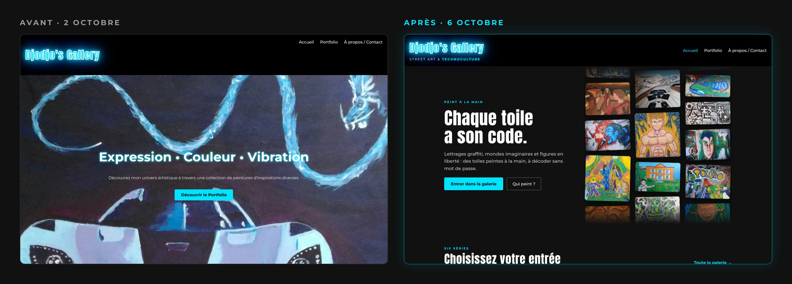
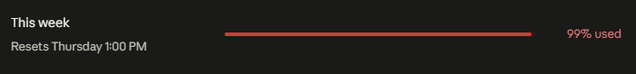
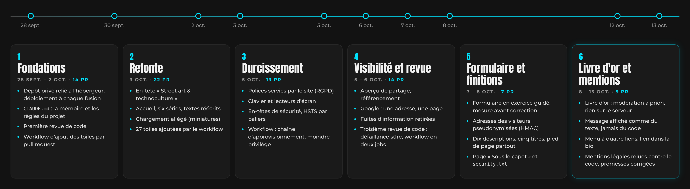
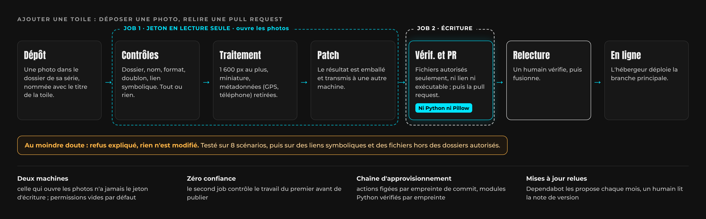
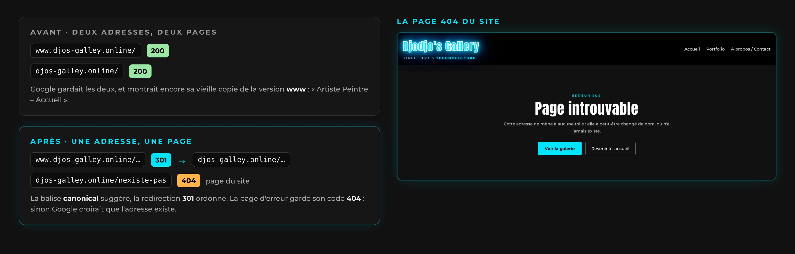
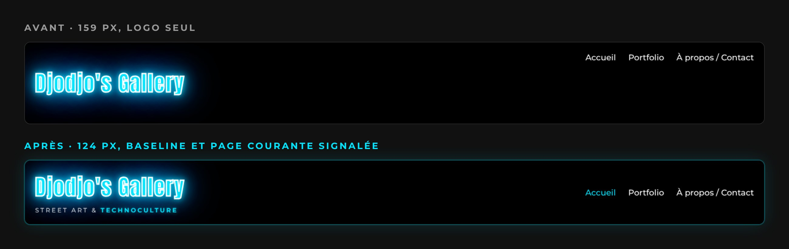
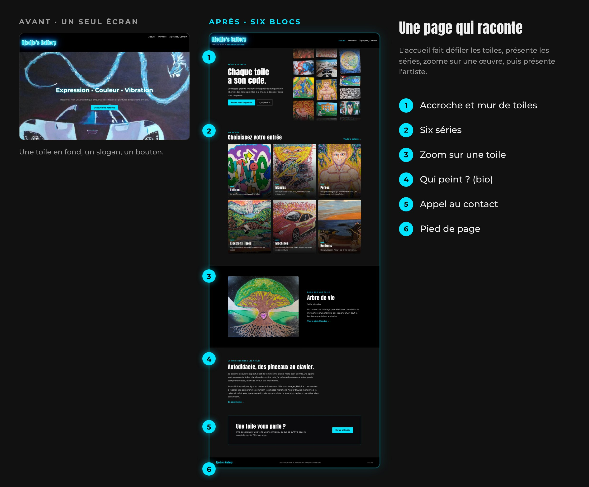
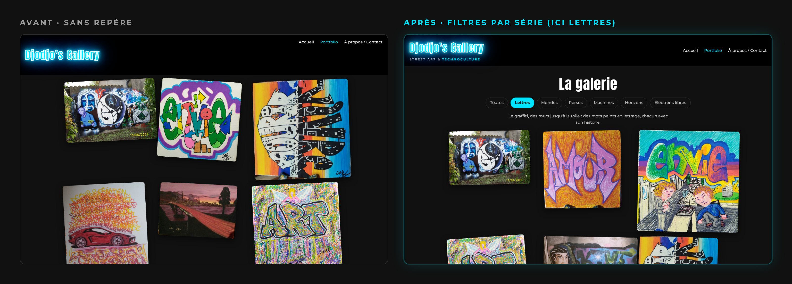
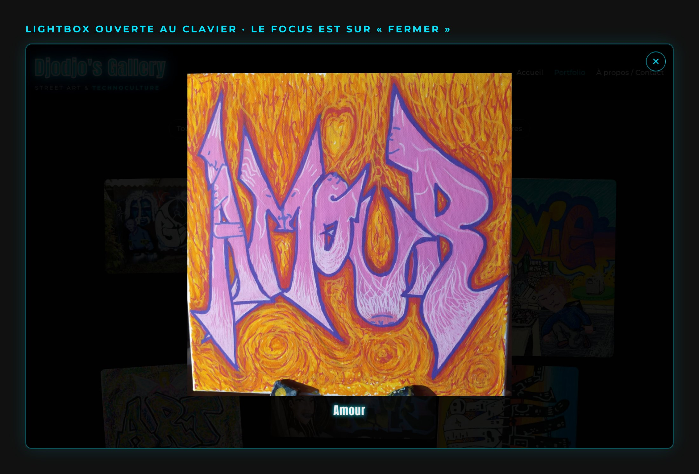

# Djodjo's Gallery — Retour d'expérience

**Refondre et sécuriser un site vitrine en vingt-cinq jours, avec une IA**

Geoffroy, alias Djodjo · en reconversion vers la cybersécurité (blue team) · octobre 2026

Site : [djos-galley.online](https://djos-galley.online) · Version PDF : [Djodjos-Gallery-retour-experience.pdf](Djodjos-Gallery-retour-experience.pdf)

## En bref

Djodjo's Gallery est le site vitrine de mes peintures : street art, lettrages graffiti, personnages, machines. Il ne vend rien. Il me sert aussi de terrain d'entraînement pour ma reconversion vers la cybersécurité.

Du 28 septembre au 22 octobre 2026, le site est passé de fichiers déposés à la main chez l'hébergeur à un projet versionné, déployé automatiquement, durci et relu. Le travail tient en **84 pull requests**, que j'ai toutes relues avant de les fusionner ou de les fermer. Dix-huit viennent du workflow d'ajout de toiles, deux de Dependabot ; les 64 autres ont été préparées avec **Claude (IA)**, l'assistant d'Anthropic.

| Indicateur | Avant | Après |
|---|---|---|
| Œuvres en ligne | 10, sans classement | 66, en six séries |
| Ajouter une toile | modifier le HTML à la main | déposer une photo, relire une pull request |
| Galerie sur téléphone (33 toiles) | 13,1 Mo | 2,4 Mo (−82 %) |
| En-têtes de sécurité HTTP | 0 | 6, version de PHP masquée |
| Ressources chargées chez un tiers | Google Fonts sur chaque page | aucune |
| Accessibilité | toiles hors d'atteinte au clavier, formulaire sans étiquettes | 0 problème détecté par l'outil axe |
| Adresses du site | `www` et adresse principale servies en double | une seule adresse (`301`), page 404 du site |

**Ce que le projet m'a fait pratiquer :** Git et GitHub (branches, pull requests, relecture), GitHub Actions, sécurité web (CSP, HSTS, en-têtes HTTP), sécurité de la chaîne d'approvisionnement, fuites d'information (OWASP WSTG), RGPD et pseudonymisation (HMAC), divulgation coordonnée (`security.txt`), accessibilité (axe, navigation au clavier), référencement (Search Console, redirections), lecture des en-têtes avec `curl`, règles Apache (`.htaccess`), travail encadré avec une IA.

> Le code du site est dans un dépôt privé. Les numéros de pull request (PR) servent de repères ; l'annexe les liste toutes.

## Qui a fait quoi

Le pied de page du site dit « conçu, codé et sécurisé par Djodjo et Claude (IA) ». Voici le partage réel.

| Moi (Geoffroy) | Claude (IA) |
|---|---|
| Objectifs, priorités et direction artistique ; l'idée de « Street art & technoculture », le nom des séries Horizons et Électrons libres | Diagnostics et quatre revues de code complètes |
| Le choix de la maquette ; la correction et la validation de tous les textes, dont ceux de « Sous le capot » et ce qu'elle ne doit jamais dire | Maquettes de l'accueil, premiers jets des textes |
| La création du dépôt et sa liaison avec l'hébergeur | Le code : HTML, CSS, JavaScript, PHP, Python, workflow GitHub Actions |
| La relecture et la fusion de chaque pull request | Les tests avant chaque PR : navigateur automatisé (ordinateur et téléphone), Apache local, serveur PHP local, outil axe |
| Les vérifications sur le site en ligne (`curl`, console du navigateur) et Search Console, propriété vérifiée par DNS | Le diagnostic de ce que Google montrait, à partir de ces vérifications |
| Les photos et les titres des toiles, les décisions de consentement, le choix des descriptions Google et de l'image de partage | La rédaction des pull requests et de `CLAUDE.md` |
| La série Persos, créée seul ; l'en-tête HSTS et la mesure de l'adresse IP réelle des visiteurs, en exercice guidé ; la clé secrète du formulaire, générée et installée par moi | La correction du formulaire (PR #64), la page « Sous le capot » (PR #69 et #70), le livre d'or et les mentions légales (PR #72, #75 et #79), les suites de la quatrième revue (PR #80 et #82), la coupure de PHP et son retrait (PR #83 et #84) |
| La modération a priori du livre d'or, le menu, le lien dans la bio, le choix de rester sous pseudonyme, la durée de conservation des messages et les coordonnées de l'hébergeur | L'explication de chaque choix et de chaque erreur, les miennes comme les siennes |

## La méthode

1. **Diagnostiquer d'abord** : le code, les textes et les toiles sont relus avant toute proposition.
2. **Montrer avant de coder** : maquettes avec les vraies toiles, captures avant chaque changement visuel.
3. **Écrire les textes à part** : rédigés et validés dans un document partagé, puis intégrés en une seule PR.
4. **Une branche et une pull request par sujet**, testée sur ordinateur et sur téléphone.
5. **Un humain fusionne** : Claude n'a jamais poussé sur la branche principale.
6. **Vérifier en ligne après la fusion** : codes de réponse et en-têtes avec `curl -I`, console du navigateur, Search Console. Ces vérifications passent par moi.

**`CLAUDE.md`, la mémoire du projet.** Ce fichier du dépôt décrit les conventions et les règles de sécurité : aucun secret dans le dépôt, aucune ressource chargée chez un tiers, commentaires publics sans détails internes, tests à faire avant chaque PR. L'IA le relit à chaque session : les garde-fous sont écrits une fois, au lieu d'être répétés à chaque conversation. Il impose aussi un suivi : chaque action de Claude est notée dans un résumé de l'état du site, qui permet de reprendre le travail ailleurs.

**Travailler avec une IA, sans lui donner les clés.** Claude n'accède qu'au dépôt du site, sur autorisation, et ne fusionne rien. Ses propositions passent par la même relecture que n'importe quelle contribution. Ses erreurs figurent dans le tableau des incidents : c'est la relecture qui les a rattrapées.

**L'IA n'est pas illimitée.** Claude s'utilise avec une limite d'usage hebdomadaire. J'ai épuisé la mienne en six jours : le 7 octobre après-midi, la jauge était à 100 %, et je n'ai plus eu accès à Claude avant sa remise à zéro, le lendemain à 13 h. C'était une erreur de ma part. J'ai mené en parallèle deux très longues conversations en réflexion étendue, un mode où Claude réfléchit plus longtemps avant de répondre, et consomme donc beaucoup plus. Je l'avais activé dans la première, et la seconde l'a gardé par défaut sans que je m'en aperçoive. Le contenu y a gagné en qualité, mais la limite a fondu. Depuis, je vérifie ce réglage à l'ouverture de chaque conversation. J'ai aussi gardé trois habitudes : une conversation par sujet, un résumé de l'état du site pour reprendre ailleurs sans tout relire, et des captures recadrées.

**Ce que l'IA change pour moi.** J'ai découvert l'IA avec Claude, et c'est un compagnon de travail remarquable. En une semaine, j'ai fait ce qui m'aurait pris, selon mon estimation, deux mois à plein temps. Mais produire avec une IA est un travail en soi : il faut formuler, relire et vérifier. L'IA a aussi un revers : je codais moins moi-même, et j'avais l'impression de pouvoir m'en tirer avec quelques notions. Vu la vitesse à laquelle Claude écrit et teste du code, apprendre à coder m'a même paru inaccessible, et presque obsolète. C'est un piège quand on vise la cybersécurité, où il faut comprendre ce qu'on défend : le but n'est pas d'écrire aussi vite qu'une IA, mais de savoir lire et juger ce qu'elle écrit. J'ai donc gardé des exercices à faire seul, avec un simple indice : l'en-tête HSTS, puis l'adresse IP réelle des visiteurs du formulaire.

Pour sortir de ce piège pour de bon, j'ai mis en place des cours de Python avec Claude Code. Je travaille sur une machine virtuelle à laquelle je me connecte en SSH depuis Visual Studio Code : c'est moi qui écris le code dans l'éditeur, et Claude Code y joue le rôle de professeur. Dans ces cours, l'IA n'écrit pas à ma place : elle encadre mon apprentissage.

## Le projet en sept temps

La frise donne l'ordre des étapes. La suite est rangée par thème : chaque sujet n'y est raconté qu'une fois, avec les PR qui le concernent.

## Le travail, par thème

### 1. Publier sans risque

Le site est déployé à chaque fusion sur la branche principale. Tout ce qui y entre, code comme toiles, doit donc passer par une relecture.

- **Un dépôt privé, un accès limité.** Le site reste public, mais le code, l'historique et une éventuelle erreur de commit ne le sont pas. L'hébergeur est relié par OAuth à ce seul dépôt, pas au compte entier. Les identifiants du formulaire de contact sont dans un fichier hors de la racine web, et aucun fichier privé n'est suivi par Git.
- **Ajouter une toile sans toucher au code** (PR #12, #22 et #48). Une photo déposée dans un dossier déclenche un workflow GitHub Actions. Il la redimensionne, retire ses métadonnées (téléphone, date, GPS), la range dans sa série et ouvre une pull request. J'ai préféré cela à une galerie listée automatiquement en PHP : le site reste statique, et un humain relit avant chaque publication. Une toile remplacée change de nom, sinon le cache de l'hébergeur garde l'ancienne image une semaine chez les visiteurs.
- **Le workflow traité comme un serveur** (PR #42, #49 et #58). Il ouvre des fichiers venus de l'extérieur et peut écrire dans le dépôt. Les actions sont désignées par l'empreinte d'un commit plutôt que par une étiquette déplaçable, les modules Python sont vérifiés par empreinte, et Dependabot propose les mises à jour, que je relis. Depuis la troisième revue de code, il tourne en **deux jobs** : le premier traite les photos avec un jeton en lecture seule ; le second ne lance ni Python ni la bibliothèque d'images, contrôle le résultat du premier (fichiers autorisés seulement, ni lien symbolique ni exécutable), et lui seul ouvre la pull request. Les liens symboliques sont refusés : un lien vers une image déjà en ligne passait pour une nouvelle toile. Depuis la quatrième revue de code (PR #82), ce contrôle juge chaque fichier selon ce qu'on lui fait : une image ne peut être ajoutée que si c'est un vrai JPEG au nom attendu, une page existante ne peut être modifiée que sans contenu actif, et seules des images ou des photos déposées peuvent être supprimées. L'ancien contrôle laissait passer un fichier rendu exécutable sans que son contenu change.
- **Le code tiers suivi** (PR #58). Le formulaire de contact s'appuie sur une bibliothèque d'envoi de mails, et rien ne surveillait sa version. Un fichier de verrouillage décrit maintenant exactement la version installée.
- **Le ménage des branches, fait par moi dans le terminal.** Avant de supprimer une branche sur GitHub, je prouve qu'elle ne contient rien de perdu : `git branch -r --merged` pour celles déjà fusionnées, `git log` et `git diff` contre la branche principale pour les branches de test. J'ai aussi essayé une suppression en masse par exclusion : l'essai à blanc (`--dry-run`) a montré qu'elle aurait supprimé ma branche de travail en cours. Depuis, je nomme les branches à supprimer, comme une liste blanche, et je fais un essai à blanc avant toute action en masse.
- **Tester sans risque.** La PR #41, ouverte exprès puis fermée, a prouvé qu'un jeton limité suffisait. Le workflow en deux jobs a été testé sur une branche jetable (PR #57), puis sur les quatre dépôts de photos suivants (PR #60 à #63), sans erreur. Le contrôle par type de changement a été éprouvé sur vingt patchs, dont dix-huit piégés, puis sur une branche jetable (PR #81, fermée).

*Réflexes : moindre privilège, zéro confiance, sécurité de la chaîne d'approvisionnement, validation des entrées en tout ou rien, secrets hors du dépôt, gestion des changements (84 PR en vingt-cinq jours).*

### 2. Durcir le serveur

- **Moins de surface** (PR #8 et #9). Page par défaut de l'hébergeur supprimée, code tiers et fichiers cachés bloqués côté serveur, liste des dossiers désactivée.
- **En-têtes de sécurité** (PR #39). Une politique de sécurité du contenu stricte : la page ne charge que des fichiers du site lui-même, et un script injecté serait bloqué par le navigateur. `Permissions-Policy` refuse caméra, micro et position. `X-Powered-By`, qui annonçait la version de PHP, est retiré.
- **HSTS par paliers** (PR #40 et #54). Cet en-tête oblige le navigateur à rester en HTTPS. Mal réglé, il peut rendre un site inaccessible pendant toute sa durée. Il a commencé à 60 secondes, puis est passé à une semaine ; il s'allongera encore (un mois, puis un an), avec une vérification à chaque palier. J'ai trouvé la ligne moi-même, en exercice guidé.
- **Une adresse, une page** (PR #54). Une recherche « djos gallery » affichait toujours l'ancien titre du site. Diagnostic avec `curl -I` et Search Console : l'adresse `www` et l'adresse principale répondaient toutes les deux `200`, et Google gardait une vieille copie de la version `www`. La balise `canonical` n'est qu'une suggestion ; une redirection `301` est un ordre. La même PR ajoute une page 404 qui garde son code d'erreur, sinon Google croirait que l'adresse existe. Le passage de `http` à `https` est déjà fait par le CDN de l'hébergeur : une règle de plus aurait pu faire tourner le site en boucle.
- **Défaillance sûre** (PR #56). Les protections du `.htaccess` étaient rangées dans des blocs `<IfModule>` : si un module manque, Apache les ignore sans rien dire. Démonstration sur un Apache local, sans le module de réécriture : des fichiers internes répondaient `200`, et le contrôle de syntaxe disait « Syntax OK ». Hors de ces blocs, un module manquant donne une erreur 500 visible, et rien ne fuit. Vérifié en ligne : les pages répondent normalement, les fichiers internes `403`.
- **403 plutôt que 404.** Faut-il cacher les dossiers internes derrière une 404, pour ne pas confirmer qu'ils existent ? Non : le gain serait de l'obscurité, pas de la protection. Et côté blue team, une 403 sur un dossier interne, dans les journaux, est un signal clair de reconnaissance, qui se noierait parmi les liens cassés.

- **Le dossier des images ne sert que des images** (PR #82). Le serveur refuse, sans l'exécuter, tout fichier de ce dossier qui n'est pas une image au nom attendu. C'est une seconde barrière derrière le contrôle du workflow : un script glissé un jour dans une pull request ne tournerait pas.
- **Une faille critique annoncée avant son correctif** (PR #83 et #84). Le 20 octobre, deux failles critiques du cœur de PHP, qui permettent d'exécuter du code à distance, ont été rendues publiques avant leur correctif. Des attaques de masse étaient attendues dès sa publication. Je me suis posé trois questions : qui corrige, le correctif existe-t-il, faut-il couper le site ? Sur un hébergement mutualisé, c'est l'hébergeur qui installe PHP ; moi, je choisis la version, et je vérifie qu'elle est encore maintenue. Plutôt que de couper le site, Claude a proposé de ne couper que PHP : le site est statique, seuls les deux formulaires l'utilisent. Une règle temporaire du serveur a refusé toute adresse PHP, sous toutes ses formes, avant qu'elle n'atteigne l'interpréteur ; les formulaires affichaient un message de pause, le reste du site ne changeait pas. Elle a été testée sur un Apache local avec une page témoin qui aurait laissé une trace si PHP avait tourné : elle n'a jamais tourné. J'ai validé et fusionné le jour même. Le lendemain, le numéro de version affiché par l'hébergeur n'avait pas changé : le correctif avait été reporté dans la version en place, sans changer son numéro. Ce numéro ne prouvait donc rien ; j'ai demandé une confirmation écrite à l'hébergeur avant de retirer la règle par une nouvelle PR, et les formulaires sont revenus.

*Réflexes : défense en profondeur, changement prudent, défaillance sûre, penser à la détection, tester avant la production, lire les en-têtes HTTP, réduire la surface en attendant un correctif, vérifier un correctif plutôt qu'un numéro de version.*

### 3. Ne rien dire de trop

Une reconnaissance commence par ce que le site dit de lui-même. Tout ce qui est public, un attaquant le lit aussi.

- **Fichiers publics nettoyés** (PR #52 et #53). `robots.txt` est souvent le premier fichier qu'on ouvre pour reconnaître un site (OWASP WSTG-INFO-03). Son commentaire citait les dossiers internes (erreur de Claude, dans la PR #50). Les commentaires du HTML et du CSS nommaient le fichier de règles du projet, le workflow et la protection du formulaire. Ce n'étaient pas des failles, puisque ces dossiers répondent `403`, mais des informations gratuites. Tout est retiré, et une règle du projet l'interdit désormais.
- **Une page « Sous le capot »** (PR #69, #70 et #75). Elle explique aux visiteurs comment le site les protège : ce que reçoit leur navigateur, le formulaire, leur vie privée, la façon dont le site est construit. Elle s'en tient aux principes : aucun seuil, aucune durée, aucun nom de fichier interne ni d'outil. Elle est passée du menu au pied de page le 12 octobre ; pour qu'un recruteur la trouve quand même, le mot « sécurise » de ma bio est devenu un lien vers elle. Elle renvoie vers ce document par un simple lien : rien n'est chargé chez GitHub avant le clic.
- **Un fichier de travail publié** (quatrième revue de code, 14 octobre). Une liste de branches à supprimer, préparée pour le ménage du dépôt, avait été déposée à sa racine : le site la servait à tout le monde. Rien de secret, mais une information gratuite sur l'organisation du dépôt. Je l'ai retirée.
- **Dire où signaler une faille.** Un fichier `security.txt` (norme RFC 9116) et une section de « Sous le capot » l'indiquent aux chercheurs en sécurité.
- **Ce document suit la même règle.** Il décrit des principes, jamais des réglages, et ne cite que des points corrigés : on ne publie pas une faiblesse encore ouverte.

*Réflexes : limiter les fuites d'information, divulgation coordonnée.*

### 4. Les données des visiteurs

Le site reçoit des données de visiteurs inconnus : leur adresse IP à chaque visite, et ce qu'ils écrivent dans les deux formulaires, le contact et le livre d'or.

**Rien chez un tiers** (PR #37). Les polices venaient de Google Fonts : chaque visite envoyait l'adresse IP du visiteur à Google, sans son accord. Elles sont maintenant servies par le site, et plus rien n'est chargé ailleurs.

**Mesurer avant de corriger** (PR #64). La revue de code soupçonnait la limite d'envois de compter la mauvaise adresse, à cause du CDN de l'hébergeur. Claude m'a donné un indice plutôt que la réponse, et j'ai mesuré : une ligne de journal temporaire, un envoi depuis le PC puis depuis le téléphone en 4G, et une comparaison avec `ifconfig.me`. Verdict : l'hypothèse était fausse. Mais la mesure a révélé un autre point, corrigé dans la même PR.

**Pseudonymiser** (PR #64). Une empreinte sans clé n'est pas anonyme : avec 4,3 milliards d'adresses IPv4 possibles, on retrouve l'adresse d'origine en quelques minutes. C'est une pseudonymisation, pas une anonymisation. J'ai essayé de corriger moi-même. Mon premier essai ajoutait un sel aléatoire à chaque envoi, ce qui empêchait de reconnaître deux envois du même visiteur : un sel protège des mots de passe, ici il fallait une clé fixe et secrète (HMAC). Après deux autres essais, j'ai demandé à Claude d'écrire la correction, que j'ai relue. Le formulaire garde désormais des empreintes à clé secrète, générée sur mon poste sans jamais s'afficher à l'écran, et les efface quand elles ne servent plus. Il refuse les envois venus d'un autre site, et s'arrête proprement si sa configuration est incomplète, au lieu de fonctionner sans protection.

Après la fusion, j'ai vérifié en ligne qu'un envoi venu d'un autre domaine était refusé et qu'un vrai message passait. J'ai aussi vidé le journal PHP des lignes qui contenaient mes adresses IP en clair : le test avait laissé des données personnelles derrière lui.

**Le livre d'or, finalement codé par Claude** (PR #72). J'avais prévu de l'écrire moi-même. Faute de temps, Claude l'a codé en m'expliquant chaque étape, et j'ai relu ; je le dis plutôt que de laisser croire le contraire. Trois principes :

- **Rien n'est publié automatiquement, rien n'est stocké sur le serveur.** Un message validé m'arrive par e-mail ; je le publie par une pull request, les autres sont supprimés. Cette modération a priori m'évite une page d'administration à protéger et des données à garder.
- **Un message est du texte, jamais du code.** La page n'écrit jamais un message comme du HTML : un script collé dans le livre d'or s'affiche sans s'exécuter (faille de type XSS stockée, testé dans un navigateur).
- **Le serveur ne fait pas confiance au navigateur.** Il vérifie lui-même les longueurs, refuse les caractères invisibles ou qui inversent le sens de lecture, les liens et les adresses e-mail, et limite les envois, par visiteur et pour tout le site (sans cette seconde limite, mille adresses différentes noieraient ma boîte de réception).

Le code commun aux deux formulaires est regroupé dans un seul fichier, pour qu'un correctif vaille pour les deux. Avant la fusion, Claude a joué une trentaine de cas d'abus (messages trop longs, données du mauvais type, caractères piégés, envois en rafale). Ces tests ont trouvé **un vrai défaut de l'ancien formulaire de contact** : un champ envoyé sous forme de liste provoquait une erreur fatale côté serveur. Il répond maintenant comme à un champ vide.

**Une seconde limite pour le contact** (PR #80). Comme le livre d'or, le formulaire de contact a maintenant une limite pour tout le site, en plus de la limite par visiteur : une seule personne disposant de nombreuses adresses pouvait sinon noyer ma boîte de réception et faire bloquer mon compte de messagerie. La même PR aligne le comptage des caractères du livre d'or : le navigateur comptait un emoji double, le serveur une seule fois, et un message valide pouvait être écarté à l'affichage.

**Les mentions légales, relues face au code** (PR #75 et #79). Je ne vends rien et je publie sous un pseudonyme : la loi autorise alors un éditeur non professionnel à rester anonyme, à condition que son hébergeur connaisse son identité et que la page nomme l'hébergeur et donne ses coordonnées. Le 13 octobre, Claude a relu la page en la comparant au code des deux formulaires :

- pour chaque donnée, la page dit maintenant pourquoi elle est traitée et sur quel fondement, qui la reçoit (l'hébergeur, comme sous-traitant), combien de temps elle est gardée, et quels droits on peut exercer ; elle prévient qu'un message du livre d'or est public et peut être indexé ;
- une promesse était plus ferme que le code, sur l'effacement des empreintes d'adresses. Je n'ai pas changé le code : j'ai corrigé les textes pour qu'ils disent ce que le code fait ;
- l'hébergeur ne publie pas de téléphone pour l'entité qui héberge mon site. Je n'ai pas inventé de numéro : la page affiche le numéro officiel que le groupe publie, et dit d'où il vient.

*Réflexes : minimisation des données, pseudonymisation, mesurer avant de conclure, sortie sûre, obligations légales et vie privée, dire ce que fait le code.*

### 5. Le site lui-même

**L'en-tête** (PR #19). « Artiste peintre » est un intitulé de métier, et la peinture n'est pas le métier que je vise. « Street art & technoculture » décrit le travail : le mot parle à la fois des machines peintes et de la carrière tech. Il s'écrit en un seul mot et en minuscule : avec un espace, on lirait « culture techno », la musique.

**L'accueil** (PR #24 à #27). D'une bannière fixe à une page qui raconte : l'accroche « Chaque toile a son code. », un mur de toiles qui défilent, les cartes des séries, un zoom sur une toile, la bio, le contact. Aucun nombre de toiles n'est affiché : il deviendrait faux à chaque ajout.

**Six séries** (PR #22 et #23). Chacune a son filtre et sa propre adresse (`portfolio.html#mondes`). La liste des séries n'existe qu'à un seul endroit, que le workflow relit : une série s'ajoute sans toucher au code. Je l'ai vérifié en créant seul la série Persos.

**Les textes** (PR #36, #55 et #67). Tous réécrits dans un document partagé, corrigés et validés : un `h1` par page, une phrase par série, une description pour Google par page, qui commence par « street art », les mots qu'on cherche vraiment. Chaque toile a une description de ce qu'on voit, distincte de son titre ; avant, un lecteur d'écran lisait parfois « fresque-1 ».

**Accessibilité** (PR #38). L'outil axe et des tests au clavier ont révélé trois problèmes : la touche Tab sautait toutes les toiles, la visionneuse n'avait pas de bouton de fermeture, et les champs du formulaire n'avaient pas d'étiquette. Chaque toile est maintenant un bouton, et la visionneuse une vraie fenêtre de dialogue : le focus va sur « Fermer », reste dans la fenêtre, puis revient sur la toile.

**Le poids des pages** (PR #7 et #29 à #31). Images de départ allégées de 18,9 à 4,4 Mo sans différence visible, puis des miniatures de 640 px avec `srcset` : le navigateur prend la plus petite image qui suffit.

**Le partage** (PR #50 et #51). Un lien du site collé dans WhatsApp, LinkedIn ou Discord affiche un aperçu : titre, description et image (balises Open Graph). WhatsApp ne montre parfois qu'un carré découpé au centre de l'image : la composition est symétrique, et j'ai choisi cette version parmi plusieurs variantes.

## Incidents et leçons

Les erreurs de Claude sont regroupées par leçon ; chaque erreur reste comptée.

| Incident | Cause | Ce que j'en retiens |
|---|---|---|
| Une image remplacée revient dans son ancienne version (28 septembre, puis 5 octobre) | Même nom de fichier ; le cache de l'hébergeur garde l'image une semaine | La leçon du premier jour avait été oubliée. Le workflow l'applique maintenant (PR #48) |
| Quatre corrections faites directement sur la branche principale : doublons et image cassée dans la galerie, carte de l'accueil cassée, formulaire modifié, fichier de travail retiré (14 octobre) | J'ai réparé à la main, hors pull request, la première fois au lieu de prendre la correction prête (PR #18) | La règle vaut aussi pour moi. La protection de branche n'existe pas pour un dépôt privé en offre gratuite : la discipline doit la remplacer |
| Des prénoms publiés, et deux PR fusionnées trop vite (#31 avant le test sur téléphone, #33 avant la relecture des titres) | PR fusionnées sans relecture ni test | Prénoms retirés six minutes plus tard, mais une publication ne s'efface jamais complètement. Une PR ouverte ne coûte rien, une erreur en ligne si |
| Deux toiles représentant des personnes réelles, titrées par leur prénom ou surnom | Publiées avant d'avoir l'accord des personnes | L'une retirée, l'autre renommée. Utiliser le portrait de quelqu'un demande son accord ; publier est irréversible |
| Conflits de fusion en série | Mon éditeur reformatait tout le fichier à chaque sauvegarde | Formater quand on le décide ; récupérer la dernière version avant de modifier |
| Dix affirmations fausses (erreur de Claude) : une PR décrivant un comportement faux, trois constats faux dans la revue de code, une faille classée « élevée » sans mesure, deux hypothèses fausses le 8 octobre, un menu à cinq liens annoncé, deux erreurs le 15 octobre (un commentaire de code sur la recherche d'un nom de fichier, l'effet d'un essai à blanc de Git) | Des constats tirés d'une sortie tronquée, d'octets comptés comme des caractères ou d'un schéma de l'architecture, sans vérification ni relecture des règles du projet | Vérifier un constat avant de le présenter. Ma mesure a infirmé la faille supposée, et révélé un autre point, corrigé (PR #64) |
| Une promesse de vie privée plus ferme que le code (erreur de Claude) | Un texte écrit sans être relu face au code | Une page de vie privée est une promesse : chaque phrase se vérifie dans le code (PR #79) |
| Une règle d'urgence trop large au premier jet (erreur de Claude), le 21 octobre | Le message d'erreur des formulaires était posé pour tout le site, et ses accents seraient arrivés cassés | Même dans l'urgence, tester aussi les cas qu'on ne vise pas : le test local l'a montré avant la PR (#83) |
| Deux correctifs sur téléphone sans effet (erreur de Claude) | Corrections sur hypothèse, sans mesure sur l'appareil | Problème encore ouvert : mesurer avant de corriger |
| Un commentaire de `robots.txt` citait les dossiers internes (erreur de Claude) | Un commentaire écrit pour expliquer, dans un fichier public | Un fichier public ne décrit jamais l'intérieur du site (PR #52) |
| Six erreurs d'organisation (erreur de Claude) : maquettes perdues dans l'éditeur, PR d'ajout en double, résumé de l'état du site en retard, deux PR fusionnées dans une branche intermédiaire, mise à jour de ce document écrite hors de sa source, une branche envoyée sans deux de ses fichiers (rattrapé avant la PR #82) | Travail découpé ou repris sans vérifier l'état réel : outil, workflow en cours, cible des PR, contrôles du document | Toujours une version image d'une maquette ; vérifier la cible d'une PR avant de la fusionner ; noter chaque action au fil de la tâche ; un contrôle ne vaut que si on passe par lui. Ces règles sont écrites dans `CLAUDE.md` (PR #71, #77 et #78) |

## La suite

- **Toiles noires sur Android** jusqu'au premier défilement : mesurer sur l'appareil (débogage USB, onglet Réseau) avant tout nouveau correctif.
- **Poids des pages** : sur un écran haute définition, la miniature de 640 px est trop petite et la galerie charge les images complètes. Il faut une taille intermédiaire, et limiter le nombre de miniatures du mur de l'accueil.
- **Tenir la durée de conservation annoncée** : trier régulièrement ma messagerie.
- **Authentification des mails** : publier SPF, DKIM et DMARC, pour que personne ne puisse envoyer de faux mails au nom du domaine.
- **HSTS** : un mois, puis un an, avec une vérification à chaque palier.
- **Des vérifications automatiques dans les pull requests** : une toile sans vraie description, un fichier de messages du livre d'or mal formé.
- **Attaquer moi-même le livre d'or**, en exercice : injection de script, envois en masse, champs trop longs.
- **Retirer une toile par un workflow**, sur les règles du workflow d'ajout : validation en tout ou rien, pull request, jeton d'écriture réservé à la dernière étape. Le partage a changé : j'écris moi-même le fichier du workflow, en exercice guidé ; Claude écrit le script Python, que je relis et teste. Le script et la première étape sont faits.
- **Un workflow pour changer la toile mise en avant sur l'accueil**, à étudier ensuite, sur le même modèle.

Me contacter : par le [formulaire du site](https://djos-galley.online/about.html).

## Annexe : les 84 pull requests

Afficher la liste

| PR | Date | Sujet | Résultat |
|---|---|---|---|
| #1 | 28/09 | Renomme peinture1.jpg en envie.jpg | fusionnée |
| #2 | 28/09 | Renomme les peintures 2 à 10 d'après leur titre | fusionnée |
| #3 | 28/09 | Supprime la barre de défilement de la page d'accueil | fusionnée |
| #4 | 28/09 | Adapte l'accueil et le menu aux petits écrans | fusionnée |
| #5 | 30/09 | Ajoute un CLAUDE.md | fusionnée |
| #6 | 02/10 | Corrige la galerie sur mobile et sous le menu | fusionnée |
| #7 | 02/10 | Remplace les photos par des versions optimisées | fusionnée |
| #8 | 02/10 | Supprime la page par défaut de l'hébergeur | fusionnée |
| #9 | 02/10 | Sécurise le dossier du code tiers et le formulaire de contact | fusionnée |
| #10 | 02/10 | Nettoie la feuille de style et le script | fusionnée |
| #11 | 02/10 | Fait du logo un lien vers l'accueil | fusionnée |
| #12 | 02/10 | Ajoute un workflow qui publie les peintures déposées dans un dossier de dépôt | fusionnée |
| #13 | 02/10 | Ajoute la peinture « Grafity » | fusionnée |
| #14 | 02/10 | Affiche le titre des peintures au survol et dans la lightbox | fusionnée |
| #15 | 03/10 | Ajoute 4 peintures | fusionnée |
| #16 | 03/10 | Mélange l'ordre des peintures à chaque visite | fusionnée |
| #17 | 03/10 | Affiche la galerie sur deux colonnes sur téléphone | fusionnée |
| #18 | — | Corrige les dimensions de quatre peintures dans la galerie | fermée sans fusion |
| #19 | 03/10 | Remplace « Artiste Peintre » par « Street art & technoculture » dans l'en-tête | fusionnée |
| #20 | 03/10 | Ajoute 4 peintures | fusionnée |
| #21 | 03/10 | Retire les quatre anciennes lignes de la galerie aux mauvaises dimensions | fusionnée |
| #22 | 03/10 | Ajoute les séries à la galerie et au workflow d'ajout | fusionnée |
| #23 | 03/10 | Range Vivre-Mourir dans Lettres et Essai dans Électrons libres | fusionnée |
| #24 | 03/10 | Refait l'accueil : mur de toiles, séries, zoom et bio (fusion 1) | fusionnée |
| #25 | 03/10 | Raconte l'histoire d'Arbre de vie dans le zoom de l'accueil | fusionnée |
| #26 | 03/10 | Retire les prénoms et resserre le texte du zoom sur Arbre de vie | fusionnée |
| #27 | 03/10 | Crédite Claude dans le pied de page de l'accueil | fusionnée |
| #28 | 03/10 | Ajoute 3 peintures | fusionnée |
| #29 | 03/10 | Accélère le chargement de la galerie avec des miniatures | fusionnée |
| #30 | 03/10 | Accélère l'affichage de la galerie sur téléphone | fusionnée |
| #31 | 03/10 | Place les peintures de la galerie sans animation | fusionnée |
| #32 | 03/10 | Ajoute 6 peintures | fusionnée |
| #33 | 03/10 | Ajoute 9 peintures | fusionnée |
| #34 | 03/10 | Ajoute la peinture « Space » | fusionnée |
| #35 | 03/10 | Retire une toile et en renomme une autre, faute d'accord des personnes représentées | fusionnée |
| #36 | 03/10 | Intègre les textes validés du site | fusionnée |
| #37 | 05/10 | Héberge les polices sur le site au lieu de Google Fonts | fusionnée |
| #38 | 05/10 | Rend la galerie et le formulaire accessibles, et corrige le lien piégé | fusionnée |
| #39 | 05/10 | Ajoute une politique de sécurité du contenu et masque la version de PHP | fusionnée |
| #40 | 05/10 | Oblige le navigateur à rester en HTTPS (HSTS), d'abord pour 60 secondes | fusionnée |
| #41 | — | Ajoute la peinture « Essai workflow » | fermée sans fusion |
| #42 | 05/10 | Sécurise le workflow d'ajout et garde le profil couleur des photos | fusionnée |
| #43 | 05/10 | Ajoute 6 peintures | fusionnée |
| #44 | — | Ajoute 6 peintures | fermée sans fusion |
| #45 | — | Workflow: Bump the actions group with 2 updates (Dependabot) | fermée sans fusion |
| #46 | 05/10 | Ajoute 19 peintures et remplace la photo de Taï Ji | fusionnée |
| #47 | 05/10 | Remplace la photo de Forum et vide le dossier de dépôt des photos déjà en ligne | fusionnée |
| #48 | 05/10 | Ajoute le remplacement automatique d'une peinture | fusionnée |
| #49 | 05/10 | Workflow: Bump the actions group with 2 updates (Dependabot) | fusionnée |
| #50 | 05/10 | Ajoute l'aperçu de partage et les bases du référencement | fusionnée |
| #51 | 05/10 | Passe l'aperçu de partage à une composition symétrique | fusionnée |
| #52 | 06/10 | Retire le commentaire de robots.txt | fusionnée |
| #53 | 06/10 | Retire des commentaires publics les indices sur l'intérieur du site | fusionnée |
| #54 | 06/10 | Redirige www vers le domaine principal, HSTS une semaine, page 404 | fusionnée |
| #55 | 06/10 | Remplace « peintre autodidacte » par « street art » dans les descriptions | fusionnée |
| #56 | 06/10 | Sort les règles du .htaccess des blocs IfModule (défaillance sûre) | fusionnée |
| #57 | — | Ajoute la peinture « Essai deux jobs » et remplace la photo de « Taï Ji » | fermée sans fusion |
| #58 | 06/10 | Workflow en deux jobs, liens symboliques refusés, suivi du code tiers | fusionnée |
| #59 | 06/10 | Garde « figuration libre » dans les textes (règle dans CLAUDE.md) | fusionnée |
| #60 | 06/10 | Ajoute 1 peinture | fusionnée |
| #61 | 06/10 | Ajoute 3 peintures | fusionnée |
| #62 | 06/10 | Ajoute la peinture « fresque-1 » | fusionnée |
| #63 | 06/10 | Ajoute la peinture « fresque-2 » | fusionnée |
| #64 | 07/10 | Protège le formulaire : clé secrète, origine et configuration | fusionnée |
| #65 | 07/10 | Ajoute 3 peintures | fusionnée |
| #66 | 07/10 | Ajoute la peinture « Château » | fusionnée |
| #67 | 08/10 | Décrit dix peintures et corrige cinq titres | fusionnée |
| #68 | 08/10 | Ajoute le pied de page au portfolio et à la page À propos | fusionnée |
| #69 | 08/10 | Ajoute la page « Sous le capot » et security.txt | fusionnée |
| #70 | 08/10 | Ajoute Sous le capot au menu et le lien vers le retour d'expérience | fusionnée |
| #71 | 08/10 | Ajoute la règle de suivi : état du site et retour d'expérience | fusionnée |
| #72 | 12/10 | Ajoute le livre d'or (modération a priori) et factorise le code des formulaires | fusionnée |
| #73 | 12/10 | Lie « sécurise » de la bio à Sous le capot | fusionnée dans une branche intermédiaire, reprise dans la #75 |
| #74 | 12/10 | Ajoute les mentions légales | fusionnée dans une branche intermédiaire, reprise dans la #75 |
| #75 | 12/10 | Livre d'or : messages avant le formulaire, lien de bio, mentions légales | fusionnée |
| #76 | 12/10 | Précise les mentions légales | fusionnée |
| #77 | 12/10 | CLAUDE.md : état du site en fin de session, feuille de route du retex, pièges de session | fusionnée |
| #78 | 13/10 | CLAUDE.md : corrige la feuille de route de ce document | fusionnée |
| #79 | 13/10 | Mentions légales : conservation, fondements, droits et promesses sur les adresses des visiteurs | fusionnée |
| #80 | 14/10 | Contact : limite du site, et longueurs du livre d'or comptées comme le serveur | fusionnée |
| #81 | — | Ajoute la peinture « Essai liste blanche » | fermée sans fusion |
| #82 | 14/10 | Workflow : liste blanche par type de changement, et le dossier des images ne sert que des JPEG | fusionnée |
| #83 | 21/10 | Met PHP à l'abri d'une faille critique annoncée | fusionnée |
| #84 | 22/10 | Rétablit PHP : retire la coupure temporaire | fusionnée |

